# Super Cool Desktop Miniatures Game (SCDMG)

[](https://github.com/CH-Potter/SCDMG/actions/workflows/ci.yml)
[](LICENSE)

**A cartoon sci-fi tabletop skirmish you play against an AI.** Push a squad of farmers with riveted rifles up a dusty valley, drown the enemy in chrome-jawed beetles, or beam in a handful of smug aliens with ray guns. Measure, aim, roll the dice and see who holds the objectives when the dust settles.

It runs in the browser or as a portable Windows app. This is an original game: the setting, factions, units and rules are all our own.

Free and open source under the [GNU GPL v3 or later](LICENSE).

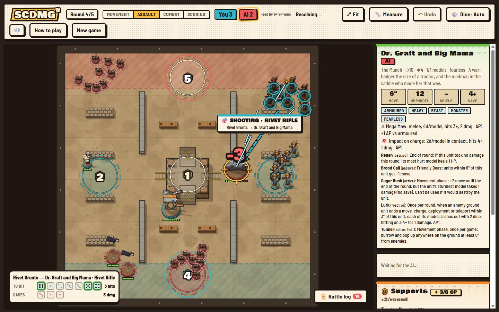

**[Download the latest release](https://github.com/CH-Potter/SCDMG/releases/latest)** · [Run it from source](#run-from-source) · [Rules](docs/rules.md) · [Lore](docs/lore.md)

## What's in it

### Three factions, three ways to fight

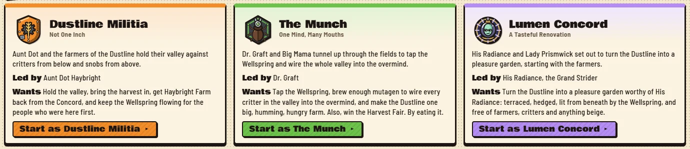

- **Dustline Militia:** scrappy frontier farmers. Rifle gunlines, artillery, overwatch and digging in, with drop-ship and airstrip arrivals.
- **The Munch:** farmland critters grafted with weapons and wired to the overmind of the evil bioengineer Dr. Graft. Cheap bodies, impact on the charge, regrowth, and tunnels to pop up where you least want them.
- **Lumen Concord:** smug alien invaders with saucers, ray guns and shields. Few elite models with precision shooting, and blinks, gates and portals to be in the right place.

Each faction's design pillars are in [docs/factions.md](docs/factions.md).

### A tabletop that shows its working

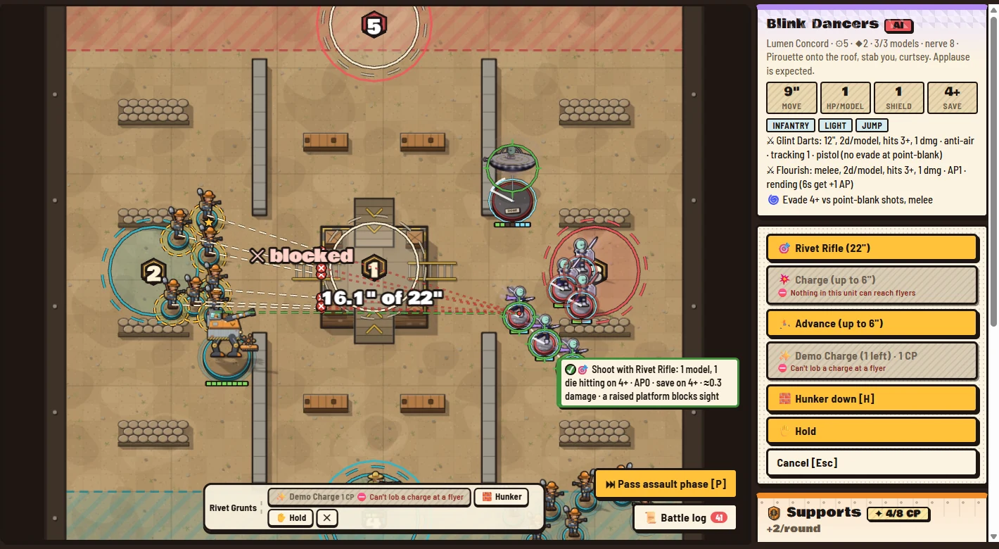

Select a unit and hover a target to see what would happen before you commit: aim lines from every model, the range, what blocks sight or gives cover, and the odds. Then roll. The dice tray can let you **throw your own dice**, roll them automatically, roll quickly or skip them. Undo takes back your last command, and the seeded dice roll the same if you redo it.

<p align="center">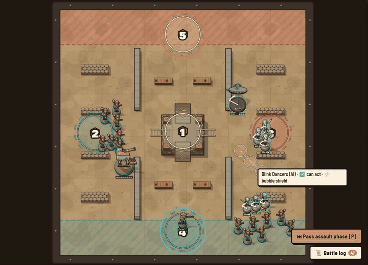</p>

- **Skirmish** on a tight 35" × 35" table, and **Assault** on a long 70" × 35" battle line with bigger armies.
- **13 maps and 14 missions**, with raised platforms, ramps and ladders, cover, channels and choke points.
- Bring a roster from the **list builder**, or play **open roster** and recruit as you go, RTS-style.
- **A greedy AI opponent** that plays every faction, and AI-vs-AI simulations for balance work.
- **Procedural music and sound**, one style per faction.

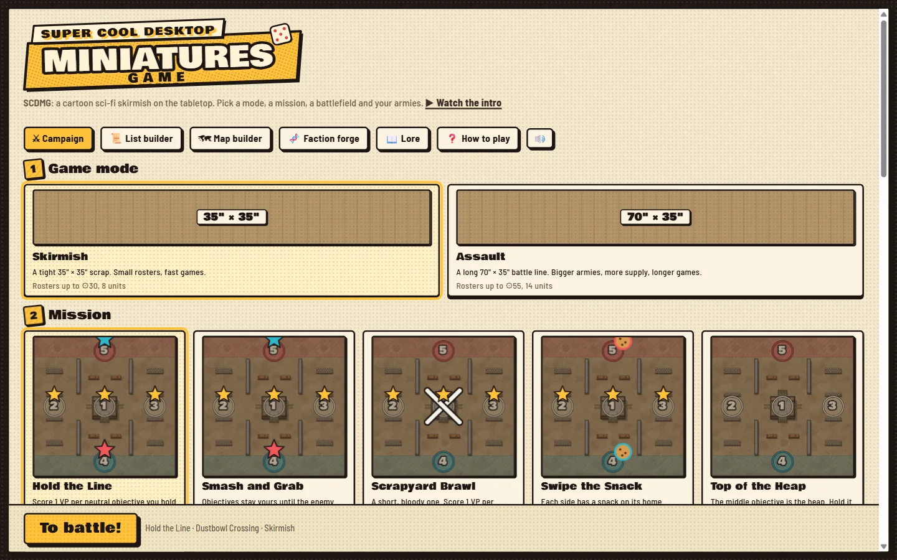

### A campaign: the Dustline War

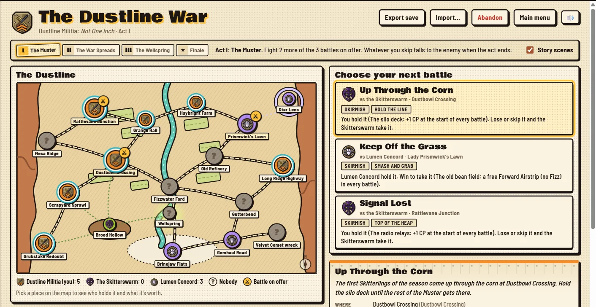

Linked Skirmish and Assault battles on a map of the valley, told from the side you pick: _Not One Inch_ for the Militia, _One Mind, Many Mouths_ for the Munch, _A Tasteful Renovation_ for the Concord. Win and you hold the place; lose and the enemy takes it. Places give small perks, your army carries over from battle to battle, and every story ends at Fizzwater Ford, over the Wellspring. See [docs/campaign.md](docs/campaign.md).

### A story to fight over

<table>
  <tr>
    <td>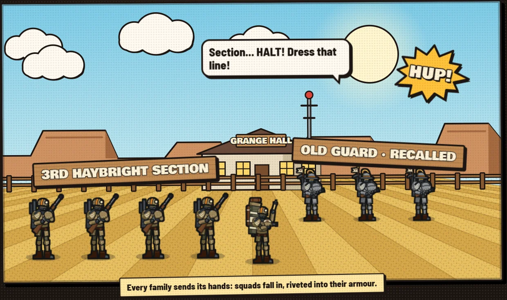</td>
    <td>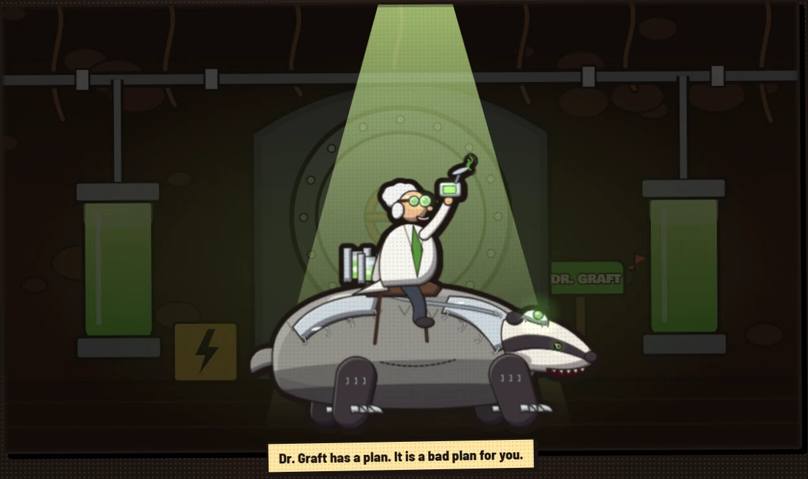</td>
    <td>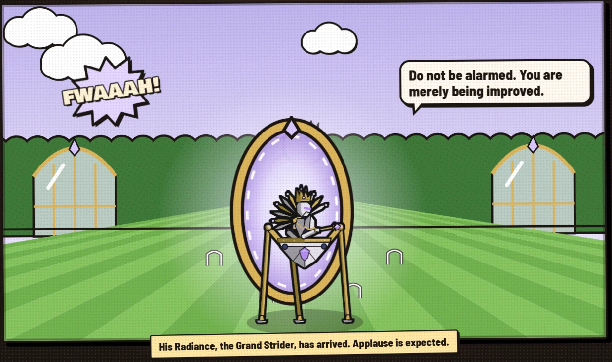</td>
  </tr>
</table>

Comic-panel intro animations, drawn live with the game's own miniatures, introduce the valley and each faction, and short story scenes play through the campaign. The **📖 Lore** pages tell the story of the Dustline, its three sides and the places they fight over (also in [docs/lore.md](docs/lore.md)).

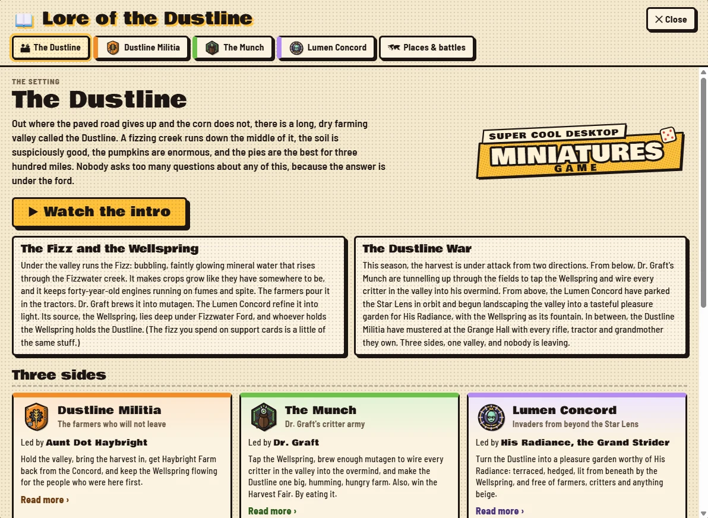

### Build your own: map builder and faction forge

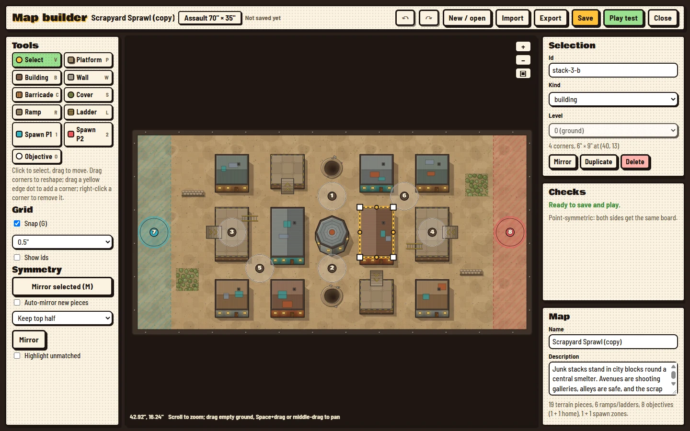

The **map builder** draws battlefields from platforms, buildings, walls, barricades, cover, ramps, ladders, spawn zones and objectives, with snapping, mirroring for symmetric boards, built-in checks and a play test. Start from a blank board or copy a built-in map.

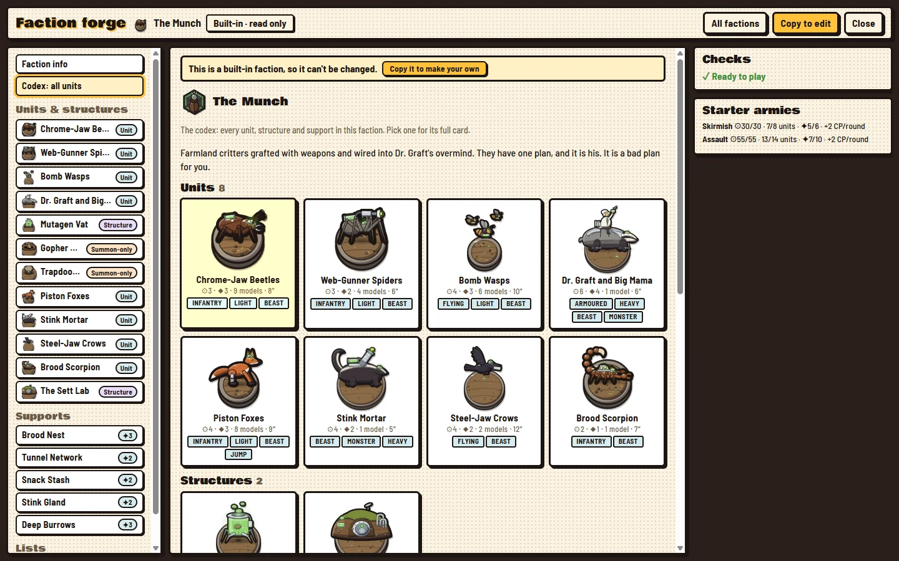

The **faction forge** shows every built-in faction's codex, and lets you copy one or start from scratch to make your own, with custom unit art.

### Mouse or touch, browser or desktop

- **Touch screens** work too: a tap that gives an order first shows the same preview a mouse pointer gets, and a second tap confirms it. Drag to pan and pinch to zoom.
- **A portable Windows build** runs offline with no install.

## Play it

### Download (Windows)

Grab `SCDMG-<version>-portable.exe` from the [latest release](https://github.com/CH-Potter/SCDMG/releases/latest) and run it. It needs no install and no Node.js, and it runs fully offline on any Windows 10/11 x64 PC.

The exe is unsigned, so on first run SmartScreen shows "Windows protected your PC". Click **More info**, then **Run anyway**. Save data (lists, maps, factions, settings) is kept in `%APPDATA%\SCDMG` and survives replacing the exe with a newer build. Press **Alt** for the File menu, which has backup, restore and "open data folder". **F11** toggles fullscreen.

### Run from source

You need [Node.js](https://nodejs.org/) 22 or newer.

```bash
npm install
npm run dev      # http://localhost:5173
npm test         # engine tests, including full AI-vs-AI games
npm run sim      # AI-vs-AI simulations across missions/maps with outcome stats (balance work)
npm run build    # typecheck + production build into dist/
```

To build the desktop app yourself:

```bash
npm run package  # builds release/SCDMG-<version>-portable.exe (~100 MB, single file)
npm run desktop  # runs the desktop build locally in Electron
```

Details, the security settings, and how to swap in a real icon are in [docs/packaging.md](docs/packaging.md).

## Rules in a nutshell

Each round has four phases: **Movement** (deploy, move, disengage, hunker), **Assault** (shoot, charge, advance), **Combat** (engaged units fight; chargers first) and **Scoring**. Players alternate activations within each phase. Armies start in reserve and deploy over time, limited by resources and a growing supply cap. Squads move by leader plus coherency; range, line of sight and cover are per model. Raised platforms are reached by ramps and ladders. Keywords such as light, armoured, heavy, flying and jump give soft rock–paper–scissors.

The full rules are in [docs/rules.md](docs/rules.md), and in the game under **❓ How to play**.

## Project layout

| Path               | What it is                                                                                       |
| ------------------ | ------------------------------------------------------------------------------------------------ |
| `src/engine/`      | Pure, deterministic rules engine: no DOM, seeded RNG, `applyCommand(state, cmd)` reducer         |
| `src/engine/data/` | Factions, units, upgrades, abilities, maps and missions (data only; tune here)                   |
| `src/engine/ai.ts` | Greedy one-activation AI: simulates candidates, scores on expected damage, objectives and threat |
| `src/ui/`          | PixiJS board renderer, DOM HUD and the controller that connects them                             |
| `src/editor/`      | Map editor                                                                                       |
| `src/forge/`       | Faction forge (custom factions and unit art)                                                     |
| `src/audio/`       | Procedural music and sound effects                                                               |
| `electron/`        | Desktop app shell                                                                                |
| `tests/`           | Vitest unit and integration tests                                                                |
| `sim/`             | AI-vs-AI balance simulations (`npm run sim`)                                                     |
| `docs/`            | Rules, faction pillars, lore, campaign, design notes, packaging and README images                |

Built with TypeScript, [Vite](https://vite.dev/) and [PixiJS](https://pixijs.com/), with [Electron](https://www.electronjs.org/) for the desktop build.

## Contributing

Bug reports, balance feedback, maps and code are all welcome. See [CONTRIBUTING.md](CONTRIBUTING.md) to get started, and [SECURITY.md](SECURITY.md) to report a security problem privately.

## Licence

[GNU General Public License v3.0 or later](LICENSE). You can use, copy, modify and redistribute the game, including commercially, as long as you share your source under the same licence and keep the copyright and credit notices (including the one on the main menu).

Copyright © 2026 Craig Potter and SCDMG contributors. Releases up to v0.7.0 were published under the MIT licence.
